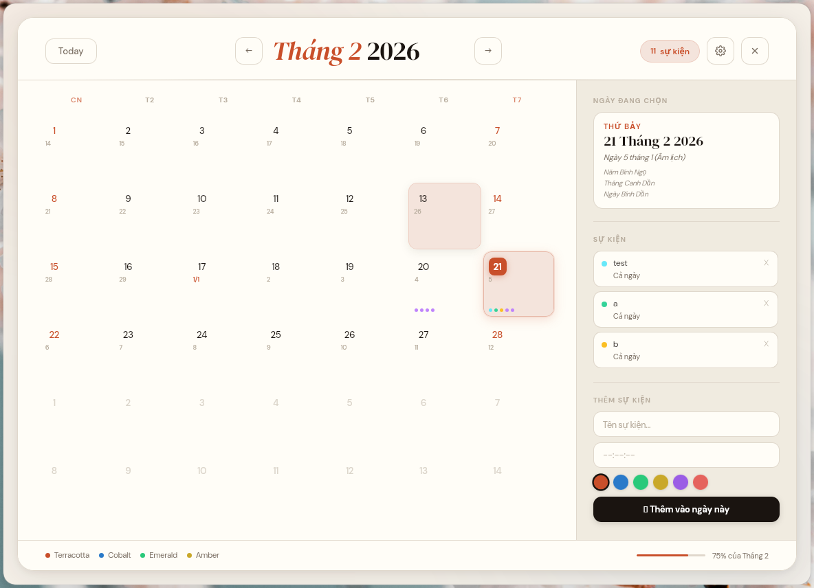

# Vate

A minimal, offline desktop calendar with Vietnamese lunar dates, built with [Tauri 2](https://v2.tauri.app/) and Rust.


## Features

- **Month view** with today highlight, weekend colouring and a "how far through the month" progress bar
- **Events per day** with an optional time and one of six colours; click an event to see its details
- **Vietnamese lunar calendar** (toggle in Settings): lunar day on every cell, plus Can Chi for the year, month and day of the selected date
- **Two languages**: English and Tiếng Việt
- **Offline and private**: events and settings are plain JSON files on your machine, with no account and no server

| Vietnamese with lunar dates | Settings |
| --- | --- |
|  |  |

## Download

**Windows:** grab the latest build from the [Releases](https://github.com/vamamurin/vate-tauri/releases) page:

- `vate_<version>_x64-setup.exe`: installer
- `vate.exe`: portable, no install needed

The executables are not code-signed, so Windows SmartScreen may show a warning the first time. Choose **More info → Run anyway**.

**macOS / Linux:** no prebuilt binaries yet; see [Build from source](#build-from-source).

## Where your data lives

| OS | Folder |
| --- | --- |
| Windows | `%APPDATA%\vate\` |
| macOS | `~/Library/Application Support/vate/` |
| Linux | `~/.local/share/vate/` |

The folder contains `jobs.json` (your events) and `settings.json` (language and lunar toggle). Back up or delete these files to back up or reset the app.

## Build from source

Requirements:

- Rust 1.77.2 or newer
- The system dependencies for your OS listed in the [Tauri prerequisites](https://v2.tauri.app/start/prerequisites/)
- Tauri CLI: `cargo install tauri-cli --version "^2" --locked`

```bash
git clone https://github.com/vamamurin/vate-tauri.git
cd vate-tauri/src-tauri

cargo tauri dev     # run in development mode
cargo tauri build   # build a release binary and installers
```

The release binary is written to `src-tauri/target/release/` and the installers to `src-tauri/target/release/bundle/`.

The frontend is plain HTML, CSS and JavaScript, so there is no Node.js or npm step.

## Project structure

```
.
├── ui/                     # Frontend (no build step)
│   ├── index.html
│   ├── css/style.css
│   └── js/
│       ├── i18n.js         # English / Vietnamese strings
│       └── main.js         # Calendar rendering, events, lunar conversion
├── src-tauri/              # Rust backend and Tauri config
│   ├── src/main.rs         # Commands: load/save events and settings
│   ├── tauri.conf.json
│   ├── capabilities/
│   └── icons/
├── docs/screenshots/
└── .github/workflows/      # Windows build and release pipeline
```

## Credits

The lunar conversion follows [Hồ Ngọc Đức's algorithm](https://www.xemamlich.uhm.vn/) for the Vietnamese calendar (UTC+7).

## License

[MIT](LICENSE) © 2026 vamamurin